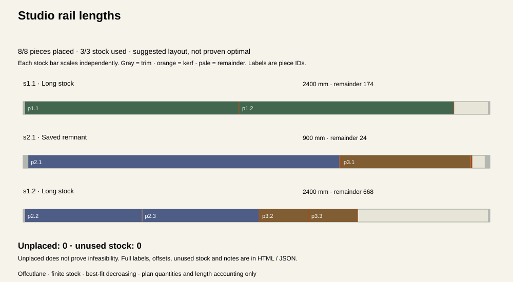

# Offcutlane

**See what fits. Keep track of what doesn’t.**

A local planner for straight cuts from finite stock lengths and remnants. Enter the lengths you have, the pieces you need, and your cut allowances. Get a deterministic suggested allocation with complete piece accounting.



*Generated SVG from the included job, not an editor screenshot.*

## Features

- Finite stock: up to **12 rows / 50 physical lengths**.
- Required pieces: up to **20 rows / 80 physical pieces**.
- Millimeters or decimal inches, parsed exactly to thousandths of the selected unit.
- Explicit start/end trim allowances and a documented kerf model.
- Stable stock and piece-copy IDs, per-piece offsets and a full length-conservation receipt.
- Visible unplaced pieces and unused stock; nothing disappears when stock runs out.
- Reversible edits with 25-step undo / redo.
- Editable project JSON, complete HTML job sheets, JSON audit receipts and an SVG overview.

No account, uploads, analytics, paid APIs or runtime dependencies.

## Run locally

Node.js 22 or 24 and npm:

```sh
npm ci --ignore-scripts --no-audit --no-fund
npm test
npm run example
npm run build
npm run dev
```

Open **http://127.0.0.1:4199**. The server binds only to loopback and serves allowlisted built assets. Rebuild after changing the source.

jsdom is a development-only dependency for simulated DOM tests. The static build uses Node built-ins.

## Plan a job

1. Start a blank job or load the invented example.
2. Choose **mm** or **in** before adding length rows. Enter your kerf and trim allowances, then save settings.
3. Add compatible stock lengths with finite quantities. A stock row can represent new lengths or existing remnants.
4. Add the finished part lengths and quantities. Every copy gets a piece ID, such as `p2.3`.
5. Inspect the suggested allocation, every **unplaced piece**, the unused stock list and the totals.
6. Save **project JSON** before closing. Open the full HTML job sheet to print or save as PDF.

Inputs accept decimals with at most three places, such as `120`, `0.035` or `0.125`. Fractions, feet/inch notation, exponents and extra decimal places are rejected rather than rounded.

Units are locked while stock or part rows exist. Starting a new blank job lets you choose another unit; there is **no automatic unit conversion**. Save or clear form drafts before other changes or downloads.

## The allocation model

All lengths in one job must refer to compatible material and cross-sections. Widths, material types and defects are not modeled.

Start and end trim allowances are removed before packing. They must already include their own cut losses; the planner does not add trim-cut kerfs.

For each placed piece:

- If the piece exactly equals the remaining usable length, it consumes the remainder with **zero final kerf**.
- Otherwise, a full kerf is charged after the piece, and the remaining length must fit both the piece and that kerf.
- A tiny tail smaller than a full kerf can leave a piece unplaced under this model. This is a modeling limit, not a conclusion about physical cutting feasibility.

Offsets are measured from the original stock start. The stock is treated as having prepared trim boundaries.

For used stock, the receipt checks:

```text
original stock length = assigned part lengths + kerf loss + trim allowances + remainder
```

Unused stock is excluded from this equation, as is unplaced demand. “Remaining” does not mean that an offcut is reusable.

### Suggested, not proven optimal

The versioned algorithm sorts pieces longest first, using original copy order to break ties. It tries an already opened stock length with the smallest remainder after placement. If none fits, it opens the shortest fitting unused stock length, breaking ties by source order.

This best-fit-decreasing heuristic can use more stock than another layout or leave pieces unplaced despite a feasible alternative. It does not prove minimum waste, minimum stock count or infeasibility. The tests include a concrete counterexample.

There is no price optimization, stock purchasing, offcut priority, unlimited supply, material grouping, 2D panel nesting, miter geometry, grain, defect exclusion or manual arrangement editor.

## Files and handoff

| Export | Contents |
| --- | --- |
| Project JSON | Exact editable fields, settings, row IDs, lengths and quantities |
| Audit receipt JSON | Entire project plus independently audited placements, geometry, totals, unplaced pieces and unused stock |
| Full job HTML | Every allocation and offset, all missing/unused copies, original rows, model settings and notes |
| Layout SVG | Visual used-stock allocations with piece IDs and an unplaced list; complete notes/labels are in HTML / JSON |

Each SVG stock bar scales independently to the available drawing width. Tiny kerfs may be subpixel; numeric receipt values remain exact. Labels appear on pieces only when the segment is wide enough. Use the full sheet for the complete list.

Actual example files: [project](examples/rails-project.json), [receipt](examples/rails-receipt.json), [job sheet](examples/rails-job.html), [layout SVG](examples/rails-layout.svg). They are invented arithmetic examples, not a build specification. The sample places all 8 pieces on 3 lengths: 5,700 mm original stock = 4,750 mm parts + 24 mm kerf + 60 mm trim + 866 mm remaining.

## Privacy and limits

Edits stay in memory. There is **no autosave** or server storage. Closing or refreshing loses work unless you downloaded project JSON. Opening a saved project replaces the current job and can be undone in the current session.

Entered data is not uploaded by the application; the host receives ordinary asset requests. Exported files can contain your notes, so share them deliberately.

A length is limited to 100,000 selected units, with thousandth-unit precision. Total stock/demand limits apply after quantities are expanded. Every stock length must exceed the combined trim allowances. Titles allow 80 UTF-16 units, labels 48 and notes 1,000. JSON imports accept this exact version’s fields only, up to 60,000 characters / 240,000 UTF-8 bytes. Invalid files reject atomically.

This is allocation arithmetic, not machine setup, a physical cutting sequence, structural design or verified material suitability. Check measurements and allowances independently before using the plan.

## Verification

`npm test` checks 5,001 exact tick roundtrips, exact-end/kerf/trim cases, a known heuristic counterexample, 80 seeded finite jobs with independent piece partition and length recounts, audit tamper rejection, maximum 50-stock/80-piece accounting, unit guards, bounded history, escaped Unicode exports, strict UTF-8 imports, actual editor event handlers, current download Blob contents and asynchronous file-read races.

CI runs Node 22/24 on Windows and Linux. UI tests use **jsdom, a simulated DOM**. Native browser interaction, responsive visual rendering, assistive technology, native download destinations, physical print output and a real editor screenshot have not been verified. No physical cutting outcomes are tested or claimed.

## Deploy on Vercel

Import this repository. Select framework **Other**, Node **24.x**, build command `npm run build`, output directory `dist`, and an empty install command. No environment variables or paid services are needed. `vercel.json` supplies these settings and security headers.

## Code

`src/model.mjs` validates and parses lengths; `pack.mjs` allocates and independently audits; `edit.mjs` handles reversible changes; `export.mjs` emits escaped documents; `app.mjs` runs the editor; `handoff.mjs` guards files and object URLs.

[File format and algorithm details](docs/file-format.md). MIT licensed.
